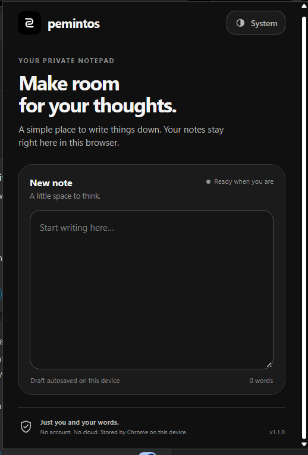

# Pemintos


**A calm, local-first notepad for Google Chrome.** Write a quick note in the extension popup, keep saved notes in your browser, and download plain-text (`.txt`) copies whenever you need them.

Pemintos is a Manifest V3 Chrome extension. It is not currently published on the Chrome Web Store, so it must be installed locally using Chrome's **Load unpacked** option.



## Features

- **Draft autosave:** your in-progress text is saved to Chrome's local extension storage as you type. Close the popup and reopen it to continue writing.
- **Saved notes library:** select **Save note** to keep a separate copy in Pemintos. The note appears in **Saved notes** below the writing area, and the draft is cleared for your next note.
- **Automatic filenames:** by default, Pemintos uses the first word of your note as the `.txt` filename. For example, `hello, i see google.com` becomes `hello.txt`.
- **Custom filenames:** choose a different filename before saving.
- **Full-page editor:** select an entry in **Saved notes** to open it in a full browser tab. Read and edit the note, then save your changes back to Pemintos.
- **Download again:** use **Download .txt** in the full-page editor to export the current note again.
- **Three appearance modes:** cycle between System, Light, and Dark themes. Your preference is stored locally.
- **Slim left-side scrollbar:** the extension uses a narrow scrollbar styled to match the monochrome interface: black in Light mode and white in Dark mode.
- **Keyboard shortcut:** `Ctrl+S` on Windows/Linux or `Cmd+S` on macOS saves the popup draft to the library and downloads it. In the full-page editor, the shortcut saves pending edits to Pemintos.
- **Word count:** the editor displays a live word count.

## How Pemintos works

### 1. Write a draft

Open Pemintos from the Chrome toolbar and type in the note field. Each edit is saved under the `noteDraft` key in `chrome.storage.local`. The draft is restored the next time the popup opens.

### 2. Save the note

When the field contains text, the **Save note** action becomes available. Selecting it stores a new note entry in the `savedNotes` collection, clears the draft field, and asks Chrome to download a `.txt` copy.

By default, the first word is used as the filename. Pemintos removes characters that are invalid in filenames and trims surrounding punctuation. You can instead select **Choose a different file name** and enter your preferred name.

Chrome may add a suffix such as `(1)` when a file with the same name already exists. Pemintos checks the resulting download name and uses that filename in the Saved notes list when Chrome provides it. If a download cannot start, the note remains saved in Pemintos.

### 3. Reopen and edit a saved note

Saved notes appear below the draft field. Select a note to open its full-page editor in a new browser tab. You can edit its text and select **Save changes** to update the stored note. The **Download .txt** action creates a new text-file copy. Closing the editor also attempts to save any edits that have not yet been saved.

### 4. Understand where notes are stored

The Saved notes library is stored inside Chrome's extension storage; it is not a regular subfolder in File Explorer or Finder. The `.txt` export is a separate file downloaded through Chrome's download manager and follows Chrome's download settings.

Pemintos uses `chrome.storage.local` for drafts, saved notes, and theme preferences. It does not require an account or a Pemintos cloud service. The current extension source does not make network requests or request access to the websites you visit.

## Download the source

Pemintos is not currently available in the Chrome Web Store. Clone the project repository using the command below. Replace the placeholder with the repository's Git URL when it is available:

```bash
git clone <repository-url>
```

## Install Pemintos in Chrome

1. Clone the repository and locate the project folder that contains `manifest.json`.
2. Open Google Chrome.
3. Enter `chrome://extensions` in the address bar.
4. Turn on **Developer mode** using the switch near the top-right of the page.
5. Select **Load unpacked**.
6. Choose the Pemintos project folder — the folder that contains `manifest.json` directly.
7. Pemintos should now appear in your extensions list. Use the puzzle-piece menu to pin it to the toolbar, then select the Pemintos icon to open the notepad.

The manifest specifies Chrome 96 or later. When you make changes to the extension's files, return to `chrome://extensions` and select the extension's **Reload** control to load the updated files.

## Project files

| File or folder | Purpose |
|---|---|
| `manifest.json` | Chrome extension manifest. Defines the extension name, version, minimum Chrome version, popup, icons, and permissions. |
| `popup.html` | Markup for the compact notepad popup, including the draft field, save controls, and saved-notes list. |
| `popup.css` | Popup layout, monochrome theme tokens, typography, component styling, responsive states, and scrollbar styling. |
| `popup.js` | Popup behavior: draft autosave, saved-note storage, filename handling, TXT downloads, theme switching, saved-note list, and keyboard shortcut. |
| `note.html` | Markup for the full-page editor used to open a saved note in a browser tab. |
| `note.css` | Styling for the full-page editor, including its themes and scrollbar. |
| `note.js` | Loads a saved note, updates its contents in local storage, downloads a TXT copy, handles theme changes, and saves pending edits when the editor is closed. |
| `icons/` | PNG icons used by Chrome in the toolbar, extensions page, and other browser UI. |
| `preview.html` | A browser-based UI preview. It provides mock Chrome extension APIs and uses browser `localStorage` for preview data; it is for visual testing, not the installed extension's storage. |
| `CREDITS.md` | Design attribution and third-party design guidance credits. |
| `README.md` | Project overview, installation, usage, behavior, and file reference. |
| `LICENSE.txt` | The supplied proprietary source-available license text. Read it before using or interacting with the source. |
| `CONTRIBUTING.md` | Explains the permitted ways to report issues and suggest improvements under the supplied license. |
| `SECURITY.md` | Describes the extension's current security and data-handling model and how to report a security concern. |
| `CHANGELOG.md` | Records the current feature set and project documentation updates. |

## Privacy and security notes

The extension currently declares only the `storage` and `downloads` permissions. It does not declare website host permissions, content scripts, or a background service worker. Drafts and saved notes are stored locally by Chrome; exported `.txt` files are ordinary files managed by Chrome's download manager.

Pemintos does not add application-level encryption to note contents. Do not use it as a password manager or for information that requires stronger protection. Anyone with access to your operating-system account or Chrome profile may be able to access local browser data. See [`SECURITY.md`](SECURITY.md) for more detail.

## License and design credits

See [`LICENSE.txt`](LICENSE.txt) for the supplied license terms. The license text is included verbatim as provided. **Please note:** the supplied text names the software as “Votrixain,” rather than “Pemintos.” Confirm that this is the intended license wording for Pemintos before publishing or relying on it; the text has not been renamed or otherwise edited here.

The interface design guidance is credited in [`CREDITS.md`](CREDITS.md) to Unslop by Damir Sokolovsky under the Creative Commons Attribution 4.0 International license. The attribution and separate third-party terms remain applicable as described in that file.
